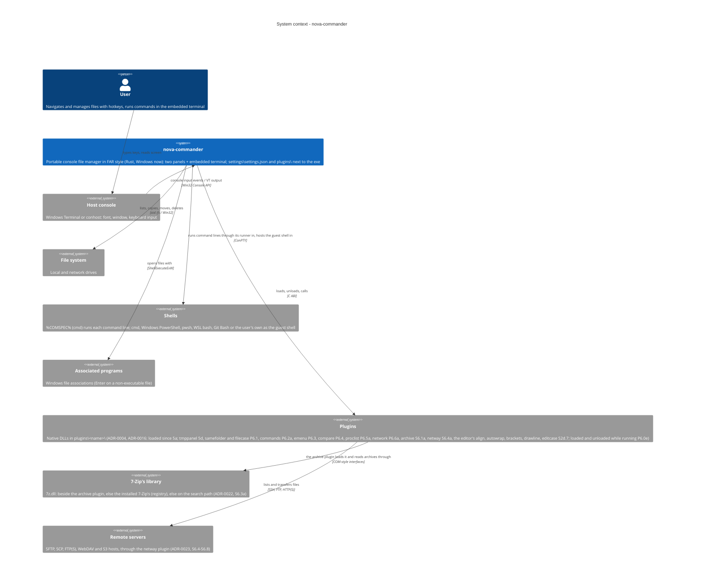

# C4 level 1 - System context: nova-commander

> Architecture as code (Mermaid). Shows the system, its user and the external systems it talks to.
> nova-commander is a single container (one executable), so the container level is folded into this diagram.
> Update it in the same change that adds or removes a user type or an external system.

